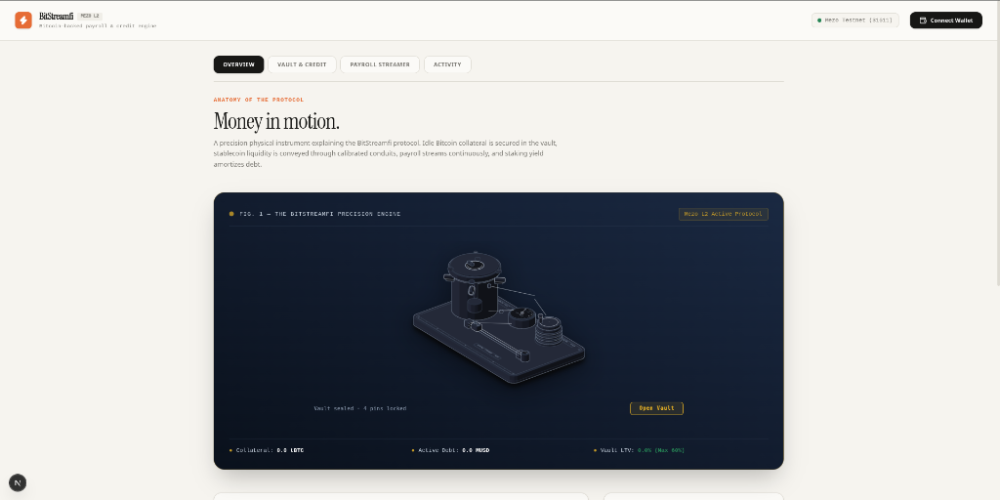

<div align="center">

# ⚡ BitStreamfi

### Bitcoin-Backed Continuous Payroll Streaming & Self-Repaying Credit Protocol on Mezo L2

[-F7931A?style=for-the-badge&logo=bitcoin&logoColor=white)](https://explorer.test.mezo.org)
[](https://soliditylang.org/)
[](https://book.getfoundry.sh/)
[](https://nextjs.org/)
[](LICENSE)

<br/>



<br/>
<br/>

**"Money in Motion"**  
*Unlock idle Bitcoin collateral on Mezo L2. Borrow stablecoin liquidity at 60% max LTV, stream second-by-second payroll in real time, and automatically amortize your debt with Bitcoin staking yield.*

---

</div>

## 📖 Overview

**BitStreamfi** transforms Bitcoin from a static store of value into an active, productive financial engine on **Mezo Network**. 

Instead of liquidating Bitcoin to pay salaries or finance operations, organizations and individuals deposit BTC collateral into a decentralized non-custodial vault, borrow MUSD stablecoins against their position, and pipe that liquidity directly into continuous second-by-second payroll streams. Simultaneously, Proof-of-HODL staking yields generated by the collateral can be fed into the credit engine to continuously pay down debt principal without out-of-pocket repayments.

---

## 🏛️ Core Protocol Pillars

### 1. 🏦 MezoFlowVault (Collateral & Credit Vault)
- **Native & Wrapped BTC Collateral**: Deposit native BTC or tBTC into a secure, reentrancy-guarded smart contract vault.
- **60% Max Loan-to-Value (LTV)**: Non-custodial borrowing of MUSD stablecoins up to 6,000 basis points (60%) of the collateral valuation.
- **Dynamic Liquidity Management**: Repay debt anytime or withdraw excess collateral while maintaining safety boundaries.

### 2. ⏳ PayrollStreamer (Continuous Second-by-Second Streaming)
- **Linear Escrow Streaming**: Salaries flow continuously into an escrow contract. Balance accrues to the payee with every second that passes:
  $$\text{Vested Amount} = \frac{\text{Deposit Amount} \times (\text{Current Time} - \text{Start Time})}{\text{Total Duration}}$$
- **Recipient-Gated Withdrawals**: Only the designated worker address can withdraw vested funds, protecting employee earnings.
- **Flexible Lifecycle Management**: Employers can top-up active streams with additional funds or cancel unvested portions with automated refunds.
- **Stream Discovery**: Built-in contract inspection allows users to instantly discover and select any stream ID on-chain.

### 3. 🔄 SelfRepayingCreditEngine (Autonomous Debt Amortization)
- **Yield Redirection**: Staking yield generated on Mezo L2 is deposited into the credit engine.
- **Automated Debt Reduction**: Calling `amortizeDebt(user, amount)` uses accrued yield to repay debt principal in `MezoFlowVault`, allowing borrowers to clear obligations without touching principal capital.

### 4. ⚡ Live Activity & Blockscout Verification
- **Zero Premature Confirmation**: Form submissions poll genuine on-chain transaction receipts via `publicClient.waitForTransactionReceipt`.
- **Persistent Local History**: Activity logs are synchronized with `localStorage` so transactions remain visible across page refreshes.
- **Direct Blockscout Integration**: Every transaction links directly to verified explorer records on Mezo L2 without format truncation errors.

---

## 🌐 Verified Deployed Contracts (Mezo Testnet - Chain ID 31611)

All protocol smart contracts are deployed and verified on **Mezo Testnet**:

| Contract Name | Deployed Address | Network / Explorer Link | Status |
|:---|:---|:---|:---:|
| **MezoFlowVault** | `0xA37a94cf5675fB41FB1911C57Be064B035630354` | [View on Mezo Explorer](https://explorer.test.mezo.org/address/0xA37a94cf5675fB41FB1911C57Be064B035630354) | **Active** 🟢 |
| **PayrollStreamer** | `0x286bEbCAEb98439eE30e919a078e271a3541C6B1` | [View on Mezo Explorer](https://explorer.test.mezo.org/address/0x286bEbCAEb98439eE30e919a078e271a3541C6B1) | **Active** 🟢 |
| **SelfRepayingCreditEngine** | `0x932A00C55055E1b89D30a298891D6aB67b24911F` | [View on Mezo Explorer](https://explorer.test.mezo.org/address/0x932A00C55055E1b89D30a298891D6aB67b24911F) | **Active** 🟢 |
| **MEZO Token (MUSD)** | `0x7B7c000000000000000000000000000000000001` | [View on Mezo Explorer](https://explorer.test.mezo.org/token/0x7B7c000000000000000000000000000000000001) | **Native Asset** 🪙 |
| **Test tBTC** | `0xc2a912D17e0DfAe27e17ef0cF3baF5beC659A6EA` | [View on Mezo Explorer](https://explorer.test.mezo.org/token/0xc2a912D17e0DfAe27e17ef0cF3baF5beC659A6EA) | **Collateral** ₿ |

---

## 🏗️ Protocol Architecture

```
   ┌─────────────────────────────────────────────────────────────┐
   │                     BITSTREAMFI PROTOCOL                    │
   └──────────────────────────────┬──────────────────────────────┘
                                  │
       ┌──────────────────────────┼──────────────────────────┐
       ▼                          ▼                          ▼
 ┌───────────┐             ┌─────────────┐             ┌───────────┐
 │  BITCOIN  │             │   MEZO L2   │             │  PAYROLL  │
 │  HODLER   │             │   NETWORK   │             │ RECIPIENT │
 └─────┬─────┘             └──────┬──────┘             └─────▲─────┘
       │                          │                          │
       │ 1. Deposit Collateral    │                          │
       ▼                          │                          │
 ┌──────────────────────┐         │                          │
 │    MezoFlowVault     │         │                          │
 │ (0xA37a...0354)      │         │                          │
 └──────────┬───────────┘         │                          │
            │                     │                          │
            │ 2. Borrow MUSD      │                          │
            ▼                     │                          │
 ┌──────────────────────┐         │                          │
 │   PayrollStreamer    │─────────┼──────────────────────────┘
 │ (0x286b...C6B1)      │         │  3. Real-Time Stream (sec by sec)
 └──────────────────────┘         │
            ▲                     │
            │ 4. Staking Yield    ▼
 ┌──────────┴───────────┐  ┌─────────────┐
 │ SelfRepayingCredit   │◄─┤ Proof-of-   │
 │ Engine               │  │ HODL Yield  │
 │ (0x932A...911F)      │  └─────────────┘
 └──────────────────────┘
   5. Amortizes Vault Debt
```

---

## 🛠️ Technology Stack

- **Smart Contracts**: Solidity `0.8.20`, Foundry (`forge`, `cast`), OpenZeppelin Contracts
- **Frontend**: Next.js 15 (App Router), React 19, TypeScript
- **Web3 Integration**: Wagmi v2, Viem v2, TanStack Query
- **Styling & Aesthetics**: Tailwind CSS, Instrument Serif & Inter typography, Paper & Ink dual-theme design system
- **Network**: Mezo Testnet (Chain ID: `31611`, RPC: `https://rpc.test.mezo.org`)

---

## 🚀 Getting Started

### Prerequisites
- [Git](https://git-scm.com/)
- [Node.js](https://nodejs.org/) (v18.17+)
- [Foundry](https://book.getfoundry.sh/getting-started/installation)

### 1. Clone the Repository
```bash
git clone https://github.com/NileshPandey05/BitStreamfi.git
cd BitStreamfi
```

### 2. Smart Contract Testing (Foundry)
```bash
# Build contracts
forge build

# Run unit and integration tests
forge test

# Run tests with detailed gas reporting
forge test --gas-report
```

### 3. Launch Frontend Development Server
```bash
cd frontend
npm install
npm run dev
```
Open [http://localhost:3000](http://localhost:3000) (or [http://localhost:3001](http://localhost:3001)) in your browser.

---

## 🔒 Security & Verification Practices

- **Reentrancy Protection**: Applied across all deposit, withdrawal, borrow, and streaming operations via custom non-reentrant guards.
- **Access Control & Validation**: Strict role checks prevent unauthorized stream cancellations or fund withdrawals.
- **Sanitized Hash Handling**: Transaction hashes are strictly formatted to 66-character hexadecimal strings to prevent 422 API errors on Blockscout.
- **Client Receipt Polling**: Interface relies on live `publicClient.waitForTransactionReceipt` rather than speculative timers.

---

## 📄 License

This project is licensed under the [MIT License](LICENSE).
