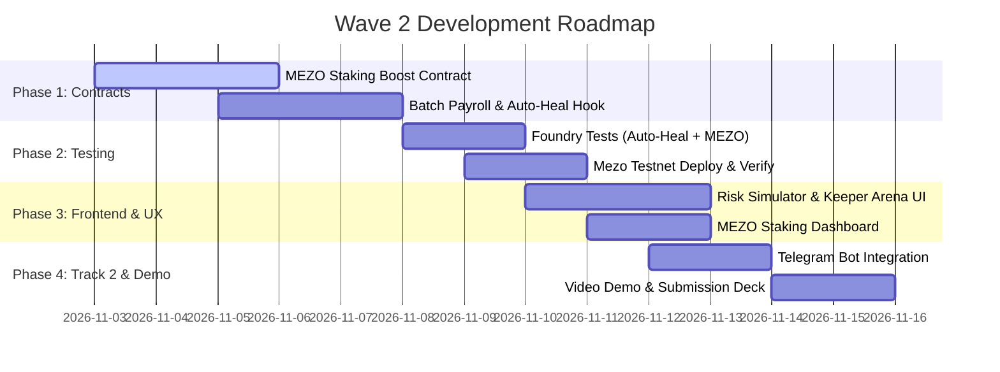

# 🚀 BitStreamfi — Wave 2 New Implementation Proposal & Discussion Board

> **Document Type:** Architecture Proposal, Feature Discussion & Implementation Roadmap  
> **Target Event:** AKINDO Wave 2 Buildathon (*Build with MUSD and MEZO: Bitcoin's Economic Layer*)  
> **Wave 2 Prize Pool:** $5,000 USD in MEZO tokens  
> **Build Period:** November 2 – November 15, 2026  
> **Evaluation Date:** November 16 – November 22, 2026  

---

## 🎯 Executive Summary: The Winning Strategy for Wave 2

In **Wave 1**, we transitioned BitStreamfi from a mock transactional prototype to a **protocol-aware foundation**:
- Integrated Mezo's native `BorrowerOperations` and live `PriceFeed` oracle ($76k+).
- Swapped mock tokens for the official Mezo Testnet MUSD (`0x1189...c503`) and live tBTC.
- Resolved all three High-severity vulnerabilities (keeper liquidation engine, native vs. tBTC collateral separation, withdrawable yield).
- Built a 22/22 passing Foundry test suite and verified contract bytecode on Mezo Testnet (31611).

In **Wave 2**, our goal is to move from **Protocol-Aware** to **"Composing Tier" (Level 3 - Top Hackathon Tier)**.  
According to judge guidelines, "Composing" requires:
1. Building multi-step DeFi primitives that combine **both MUSD and MEZO**.
2. Solving a real-world financial loop that makes idle Bitcoin productive without human micromanagement.
3. Expanding access through seamless distribution (Track 2 bonus).

---

## 🧭 Feature Comparison: Wave 1 vs. Proposed Wave 2

| Dimension | Wave 1 Status (Foundation) | Wave 2 Proposed Implementation (Winner Tier) |
| :--- | :--- | :--- |
| **Mezo Protocol Composition** | Vault interacts with Troves for admin deposits. | **Dynamic Self-Healing Trove**: Automated collateral rebalancing & flash-debt amortizing directly from active payroll streams. |
| **Token Economy** | Uses MUSD only. MEZO token was passive. | **Dual-Token Flywheel (MUSD + MEZO)**: Lock MEZO governance tokens to boost stream yield, reduce borrowing interest, and earn protocol fees. |
| **Payroll Scalability** | Single stream creation only (1 employer $\rightarrow$ 1 employee). | **Enterprise Batch Payroll**: CSV upload / multi-recipient dispatch in 1 single atomic transaction. |
| **Risk & Liquidation UX** | Basic display of ICR and keeper liquidation function. | **Interactive Trove Health Simulator & Live Keeper Arena**: Interactive price shock visualizer, 1-click protection, and public liquidator UI. |
| **Distribution (Track 2)** | Web dashboard only. | **Telegram Notification Bot & Mini-App**: Live salary notifications, ICR warning pings, and one-tap mobile stream claims. |

---

## 💡 Top 5 New Implementation Proposals for Wave 2

---

### Proposal 1: 🔄 Closed-Loop "Self-Healing Trove" & Stream-to-Debt Amortization
**Track:** Track 1 (DeFi & Composable Credit)  
**Complexity:** Medium-High | **Impact on Judges:** Extremely High ⭐⭐⭐⭐⭐

#### Problem
Borrowers who lock Bitcoin collateral to stream payroll still face liquidation risk if BTC market price dumps sharply while salaries are flowing out.

#### The Wave 2 Solution
Create an automated **Self-Healing Hook** linking `PayrollStreamer` and `MezoFlowVault`:
1. **Unvested Escrow Buffer**: When an employer creates a payroll stream, any unvested MUSD buffer can be earmarked as emergency reserve collateral.
2. **Auto-Amortize on Price Drop**: If the employer's Trove ICR drops below 135% (approaching the 110% Liquidation line), the contract automatically halts further unvested stream outflows and routes that MUSD directly to `BorrowerOperations.repayMUSD()`, restoring Trove health to >170% without requiring the employer to wake up in the middle of the night.
3. **Employee Debt-Splitter**: Employees receiving MUSD can opt-in to allocate a percentage (e.g., 15%) to automatically pay down their own personal debt or deposit into an auto-compounding savings pool.

```
                  ┌──────────────────────────────┐
                  │    BTC Market Price Drops    │
                  └──────────────┬───────────────┘
                                 │
                                 ▼
                  ┌──────────────────────────────┐
                  │     Trove ICR Drops < 135%   │
                  └──────────────┬───────────────┘
                                 │
                     [Auto-Healing Trigger]
                                 │
                                 ▼
         ┌────────────────────────────────────────────────┐
         │ MezoFlowVault pulls emergency MUSD from stream │
         │   and calls BorrowerOperations.repayMUSD()     │
         └───────────────────────┬────────────────────────┘
                                 │
                                 ▼
                  ┌──────────────────────────────┐
                  │    Trove ICR Restored >170%  │
                  │     Liquidation Averted!     │
                  └──────────────────────────────┘
```

---

### Proposal 2: 🪙 Dual-Token Composable Flywheel: MEZO Token Staking & Fee Boost
**Track:** Track 1 (DeFi) & Hackathon Mandate (*"Build with MUSD and MEZO"*)  
**Complexity:** Medium | **Impact on Judges:** Maximum ⭐⭐⭐⭐⭐

#### Why This Wins
The hackathon specifically rewards protocols that integrate **both MUSD and MEZO**. Currently, our vault only uses MUSD. Adding MEZO gives the protocol genuine tokenomic utility.

#### Specification: `MezoStakingBoost.sol`
1. **MEZO Staking Tiers**:
   - **Bronze** (100 MEZO): 10% discount on vault borrowing fees.
   - **Silver** (500 MEZO): 25% discount + 0.5% stream vesting speed boost.
   - **Gold** (2,500 MEZO): 50% discount + zero stream cancellation penalties + priority keeper liquidation rights.
2. **Protocol Revenue Sharing**:
   - Vault borrow fees (e.g., 0.5%) are collected in MUSD and channeled to a staking pool that distributes rewards to MEZO stakers.
   - This creates a sustainable economic flywheel: **More Bitcoin Locked $\rightarrow$ More MUSD Streamed $\rightarrow$ Higher MEZO Staking APY**.

---

### Proposal 3: 🏢 Enterprise Batch Payroll Engine & Contractor Milestones
**Track:** Track 1 (DeFi) & Track 2 (Usability)  
**Complexity:** Medium | **Impact on Judges:** High ⭐⭐⭐⭐

#### Problem
In real-world companies, HR does not create 50 separate streams one by one and sign 50 MetaMask prompts.

#### The Wave 2 Solution
1. **1-Click Multi-Stream Dispatcher (`BatchPayroll.sol`)**:
   - HR uploads a CSV or pastes a list of addresses:
     ```csv
     recipient,amount_musd,duration_days,cliff_days
     0x71C...a19,3500,30,0
     0x8B2...f90,4200,30,7
     0x3E1...c44,2800,15,0
     ```
   - In a single atomic transaction, the contract borrows the combined MUSD against the employer's BTC vault and spins up all 3 streams concurrently.
2. **Cliff Vesting & Milestone Streaming**:
   - Support for probation periods (e.g. 14-day cliff before second-by-second linear vesting starts).
   - Employer milestone release triggers for freelance deliverables.

---

### Proposal 4: 📊 Interactive Trove Risk Simulator & Public Keeper Liquidation Arena
**Track:** Track 1 (DeFi) & UI/UX Excellence  
**Complexity:** Low-Medium | **Impact on Judges:** Very High ⭐⭐⭐⭐⭐

#### Specification
1. **Dynamic "What-If" Stress Test Slider**:
   - A visual slider in the UI: *"Simulate BTC price change from -40% to +50%"*.
   - Live calculations show:
     - Predicted ICR change in real time.
     - Distance to liquidation threshold.
     - Recommended BTC collateral to deposit to remain 100% safe.
2. **Public Keeper Liquidation Arena**:
   - A dedicated tab showing all undercollateralized or near-liquidation vaults on Mezo Testnet.
   - Any external user or MEZO keeper can click **"Liquidate Position"** to repay the bad debt and seize the collateral + **5% keeper bonus** in one click.
   - Proves to judges that the liquidation engine is active, permissionless, and economically incentivized.

---

### Proposal 5: 📱 Telegram Alert Bot & One-Tap Mobile Claim (Track 2: Access & Distribution)
**Track:** Track 2 (Access & Distribution)  
**Complexity:** Low-Medium | **Impact on Judges:** Very High ⭐⭐⭐⭐⭐

#### Why This Is a Super-Lever
Track 2 of the hackathon specifically targets: *"Telegram/WhatsApp transaction bots, discovery platforms, aggregators, reducing friction for discovery, access, and usage"*.  
Building a Telegram integration allows us to submit to **both Track 1 AND Track 2**, doubling our award potential!

#### Features
1. **Worker Telegram Notification Bot**:
   - Workers link their Mezo address to `@BitStreamfiBot`.
   - Bot sends periodic updates:
     > *"⚡ Payday Every Second! You have accrued 142.50 MUSD from Acme Corp. [Claim to Wallet] / [View Stream]"*
2. **Employer Trove Risk Alerts**:
   - Instant push notifications if BTC market volatility threatens the employer's vault:
     > *"⚠️ Trove Alert: Your ICR has dropped to 132% due to BTC moving to $72,100. Top up 0.02 BTC or enable Auto-Heal to prevent liquidation."*
3. **Telegram Mini-App Web3 View**:
   - Run the BitStreamfi mobile dashboard directly inside Telegram without opening an external browser!

---

## 🏛️ Proposed Architecture Diagram (Wave 2 Full Vision)

```
┌─────────────────────────────────────────────────────────────────────────────────┐
│                               BITSTREAMFI WAVE 2                                │
├──────────────────────────────────────┬──────────────────────────────────────────┤
│           TRACK 1: DEFI              │       TRACK 2: ACCESS & DISTRIBUTION     │
└──────────────────┬───────────────────┴────────────────────┬─────────────────────┘
                   │                                        │
      ┌────────────┴────────────┐              ┌────────────┴────────────┐
      ▼                         ▼              ▼                         ▼
┌───────────────┐       ┌───────────────┐┌───────────────┐       ┌───────────────┐
│ MezoFlowVault │       │ MEZO Staking  ││ Batch Payroll │       │ Telegram Bot  │
│  Auto-Heal    │       │  Boost & Fly- ││ Multi-Stream  │       │ & Mini-App    │
│  Trove Engine │       │  wheel Pool   ││  Dispatcher   │       │ Notifications │
└──────┬────────┘       └───────┬───────┘└───────┬───────┘       └───────┬───────┘
       │                        │                │                       │
       ▼                        ▼                ▼                       ▼
┌─────────────────────────────────────────────────────────────────────────────────┐
│                           MEZO TESTNET CORE ECOSYSTEM                           │
│  • BorrowerOperations  • PriceFeed Oracle  • MUSD Token  • MEZO Governance Token│
└─────────────────────────────────────────────────────────────────────────────────┘
```

---

## 📅 Recommended Wave 2 Sprint Schedule (Nov 3 – Nov 15)



---

## 🗳️ Discussion & Decision Matrix: Which Features Should We Build First?

Please review and select which combination of features aligns best with your vision:

| Option | Package Name | Included Features | Estimated Effort | Prize Impact |
| :---: | :--- | :--- | :---: | :---: |
| **Option A (Recommended)** | **The Dual-Track Grand Slam** | • Feature 1 (Self-Healing Troves)<br/>• Feature 2 (MEZO Staking Flywheel)<br/>• Feature 4 (Risk Simulator & Keeper Arena)<br/>• Feature 5 (Telegram Bot) | 4-5 days | ⭐⭐⭐⭐⭐ *(Targets both Track 1 & Track 2 for maximum prize)* |
| **Option B** | **Pure DeFi Composable Powerhouse** | • Feature 1 (Self-Healing Troves)<br/>• Feature 2 (MEZO Staking Flywheel)<br/>• Feature 3 (Batch Payroll Engine)<br/>• Feature 4 (Risk Simulator) | 3-4 days | ⭐⭐⭐⭐ *(Deep Track 1 dominance)* |
| **Option C** | **Fast & Focused Polish** | • Feature 2 (MEZO Staking Flywheel)<br/>• Feature 4 (Risk Simulator & Keeper Arena UI) | 2 days | ⭐⭐⭐ *(Safe, rapid execution)* |

---

### 💬 Next Steps: What Would You Like to Execute First?
Tell me which features you'd like to implement, or if you'd like to proceed with **Option A (The Dual-Track Grand Slam)** starting with the **MEZO Staking Boost** and **Trove Risk Simulator**!
